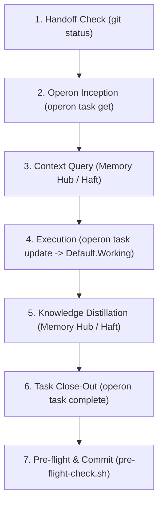

# Operon CLI & Task Runtime

Operon is the primary task management engine and workflow runtime for the PKMxKB workspace.[^operon-catalog-live] It provides a bifurcated operational surface:
1. **Obsidian Plugin GUI** (`operon 3.12.0`): Utilized by Hilmi for visual task management (boards, tables, filters, timers, and radial timeline visualizations).
2. **Operon CLI** (`/Users/healmiy/.nvm/versions/node/v24.18.0/bin/operon`): Utilized by **Aigents** (CLAi, IDEAi, AiPhone) to inspect, query, adopt, create, and transition tasks programmatically while maintaining live state invariants.[^operon-cli-manifest]

> [!IMPORTANT]
> **Aigent Operational Contract:** Aigents must avoid manual regex/string manipulation of task metadata whenever `operon` CLI subcommands can execute the transition. The CLI enforces atomic recurrence calculations, active timers, child task counters, and status validations.

---

# Schema

### 1. Live Pipelines & Statuses

Operon tracks task progression via explicit pipelines in `Pipeline.Status` notation.[^operon-catalog-live]

#### A. `Default` Pipeline (`pl_project`) — Workspace Standard
The primary pipeline for all general vault operations, engineering tracks, and personal tasks:

| Status | Stage Name | State Class | Description |
|---|---|---|---|
| `Default.tbd` | Brainstorming / Backlog | `open` | Idea captured, not yet scheduled or actionable. |
| `Default.Todo` | Planned | `open` | Actionable task queued for execution. |
| `Default.Working` | In Progress | `open` | Actively being executed by an Aigent or human operator. |
| `Default.Done` | Paused / On Hold | `open` | Work begun but temporarily suspended or awaiting input. |
| `Default.Complete` | Finished | `finished` | Successfully completed and signed off. |
| `Default.Completed` | Dropped / Cancelled | `cancelled` | Intentionally abandoned, superseded, or cancelled. |

#### B. `IV` Pipeline (`pl_mufyevec8s4s6j`) — Recruitment & Interviews
Dedicated exclusively to job interviews and external recruitment stages:
- `IV.tbd` $\rightarrow$ `IV.Todo` $\rightarrow$ `IV.Working` $\rightarrow$ `IV.Done` $\rightarrow$ `IV.Complete` / `IV.Completed`

### 2. Priority Hierarchy
- `Press` (P1 / Critical / Urgent)
- `House` (P2 / High / Core milestone)
- `Author` (P3 / Standard / Normal priority)
- `Zero` (Default / P4 / Routine / Backlog)

### 3. Task Syntax & Field Definitions

Inline tasks are stored directly inside Markdown notes with double-colon properties:

```markdown
- [ ] Implement Operon documentation {{operonId:: rmvb0p8}} {{status:: Default.Working}} {{priority:: Author}} {{dateScheduled:: 2026-10-13}} {{note:: In progress by Aigent}} {{datetimeCreated:: 2026-10-13T00:03:27}}
```

| Field Name | Property Key | Type | Owner | Role |
|---|---|---|---|---|
| Task ID | `operonId` | `text` | Runtime | Unique 7-character alphanumeric identifier (e.g., `rmvb0p8`). |
| Status | `status` | `text` | `tasks.transition` | Live pipeline stage (e.g., `Default.Working`). |
| Priority | `priority` | `text` | `tasks.update` | `Press`, `House`, `Author`, or `Zero`. |
| Scheduled Date | `dateScheduled` | `date` | `tasks.update` | Intended execution date (`YYYY-MM-DD`). |
| Deadline | `dateDue` | `date` | `tasks.update` | Strict completion deadline (`YYYY-MM-DD`). |
| Date Completed | `dateCompleted` | `date` | `tasks.transition` | Timestamp stamped automatically upon task completion. |
| Parent Task | `parentTask` | `text` | `tasks.relationship` | Foreign key referencing parent `operonId`. |
| Dependencies | `blocking` / `blockedBy` | `list` | `tasks.relationship` | Semicolon-delimited lists of dependent `operonId`s. |
| Note | `note` | `text` | `tasks.update` | Brief context or operational log note. |
| External Links | `links` | `list` | `tasks.update` | Supporting URLs or documentation links. |

---

# Examples

### 1. Runtime Health & Diagnostic Inspection
Verify runtime admission and available capabilities before starting tasks:[^operon-cli-manifest]

```bash
# Verify runtime admission (must show reads: yes, writes: yes)
operon health

# Inspect all 52 available engine capabilities
operon capabilities

# Read live pipeline and field catalog
operon catalog
```

### 2. Inspecting an Existing Task
```bash
# Read exact task details by ID
operon task get --id <operonId>

# Read full JSON payload for programmatic evaluation
operon task get --id <operonId> --json
```

### 3. Transitioning Task State
```bash
# Set a task to in-progress (Working)
operon task update --id "<operonId>" status::"Default.Working"

# Complete a task atomically (stamps dateCompleted and marks checkbox [x])
operon task complete --id "<operonId>"

# Reopen a completed or cancelled task
operon task reopen --id "<operonId>"

# Cancel a dropped task
operon task cancel --id "<operonId>"
```

### 4. Updating Metadata & Relationships
```bash
# Update priority and execution note
operon task update --id "<operonId>" priority::"Press" note::"Awaiting review"

# Establish a parent-child hierarchy
operon task update --id "<operonId>" parentTask::"<parentOperonId>"

# Declare blocking dependency
operon task update --id "<operonId>" blocking::"<targetOperonId>"
```

### 5. Task Creation & Adoption
```bash
# Create a new inline task under Default pipeline
operon task create inline "Verify database backups" status::"Default.Todo" priority::"House"

# Adopt a raw markdown checkbox into Operon (assigns a fresh operonId)
operon task adopt --description "Existing raw markdown task"
```

---

# Workflow Integration

Operon serves as the primary task state machine for the **PKMxKB Aigent Execution Loop**:[^execution-loop-sop]



1. **Inception (Step 2):** Resolve task scope and goals via `operon task get --id <operonId>`.
2. **Execution (Step 4):** Shift stage to `Default.Working`. Log work in the nearest `log.md` with explicit task reference: `- feat: [<Summary>] <Details> (refs: [[<Task Note>]])`.
3. **Close-Out (Step 6):** Run `operon task complete --id <operonId>` to seal the task before staging git commits.

---

[^operon-cli-manifest]: [Operon CLI Manifest](file:///Users/healmiy/.nvm/versions/node/v24.18.0/bin/operon) — Command definitions, contract schemas, and flags.
[^operon-catalog-live]: Operon Runtime Catalog — Extracted live via `operon catalog` for profile `pkmxkb`.
[^execution-loop-sop]: [Execution Loop SOP](file:///Users/healmiy/archAive/raw/sources/PKMxKB/.agents/workflows/execution-loop.md) — 7-step mandatory protocol for autonomous agents.
